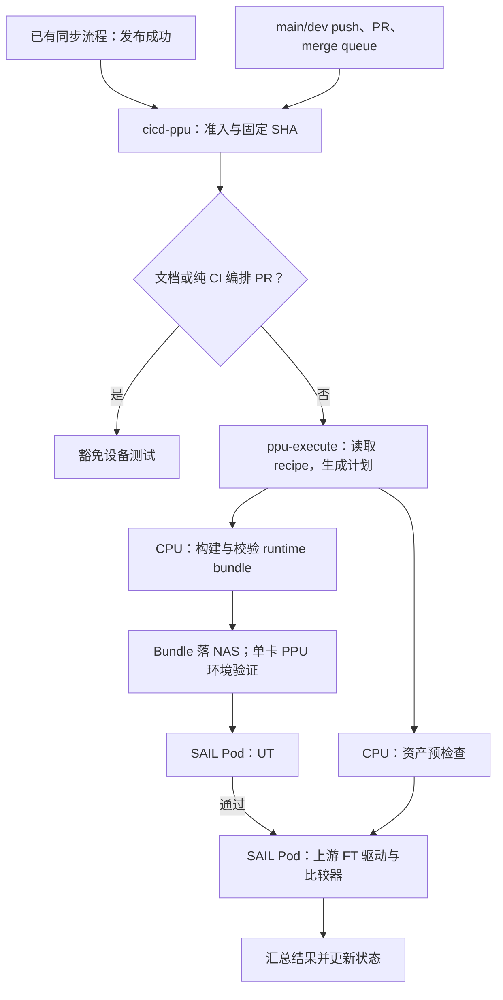

# SAIL PPU CI

[English](ppu-ci.en.md) | 中文

复用 NVIDIA recipe、UT/FT 驱动和数值比较器。SAIL 只维护准入与选例、平台环境、
runner/NAS 接线、M890 golden 和结果汇总；不在适配层重新实现模型测试。

## 流程与触发



- 同步沿用现有 main 候选 PR / dev 直接发布机制。发布后通过 `sync_request`
  调用 `cicd-ppu.yml`，无需依赖 `GITHUB_TOKEN` push 再触发 Actions。
- 普通 push、同步和无标签 PR：UT quick、FT L0、运行一次、每 case 30 分钟训练预算。
  `Run tests` 选择轻量观察，`Run functional tests` 扩大数值测试到 L1。
- 文档和纯编排 PR 豁免设备；镜像、依赖、执行脚本、recipe、golden 和模型代码仍需测试。
  自动 combined 路径先 UT 后 FT，共用 runtime bundle；任一失败则组合失败。
- 手动 `cicd-ppu.yml` 支持单 UT bucket、FT assets 或 regression。assets 不训练；
  release tag 当前只执行 UT。手动诊断使用受信任的 main/dev 分支。
- `ppu-control-tests.yml` 是独立的 CPU 脚本回归，只在相关路径 PR 或手动运行时执行，
  不是每次 Build/UT/FT 的前置 job，也不消耗 PPU。

`ppu_policy.py` 集中维护规则；`ppu_pr_authorize.py` 读取 GitHub 状态、固定 head/base/merge SHA，
并在排队后复查，防止旧提交的结果用于新提交。SAIL 保留 `pull_request_target` 入口，
没有接入 NVIDIA copy-pr-bot 或 NVIDIA runner。控制代码来自受信任分支，被测代码使用固定的 target SHA。

## 维护入口

下表脚本均在 `.github/scripts/`，完整路径除外；只为实际平台差异保留适配，不增加通用 CI 框架。

| 内容 | 入口 |
|---|---|
| 触发、权限、测试范围 | `ppu_policy.py`、`ppu_pr_authorize.py`；UT quick 清单 `.github/ppu-pr-tests.json` |
| UT | `ppu_ci.py`、`ppu_ci_run.sh`、`ppu_pytest_policy.py`，调用上游 UT 驱动 |
| FT 选例与运行 | `ppu_functional.py`、`ppu_functional_runtime.py`，调用上游 `run_ci_test.sh` |
| 平台环境 | `.github/docker/Dockerfile.ppu-ci`、`ppu_ci_container.py`、`ppu_functional_environment.py` |
| 数据与 tokenizer | `ppu_ci_paths.py`、`ppu_functional_hf.py`、`.github/ppu-functional-tokenizers.json` |
| 结果与日志 | `ppu_functional_results.py`、`ppu_functional_pytest.py`、`ppu_ci_export.py` |

仓库变量 `PPU_CI_ENABLED=true` 开启设备流程；GitHub environment 使用 `ppu-ci`。
存储接线使用 secrets：`PPU_HOST_VOLUMES`、`PPU_CPU_RUN_ROOT`、`PPU_POD_RUN_ROOT`、
`PPU_CPU_ASSETS_ROOT`、`PPU_POD_ASSETS_ROOT`。CPU 与 Pod 路径必须映射到同一共享数据。
公共 artifacts 只导出 JSON 报告/指标、原始模型配置、文本日志及必要的控制脚本，并脱敏路径。
其余文件（含展开配置、TensorBoard、checkpoint 和缓存）保留 NAS；不另建上传文件清单协议。

## 运行环境交付与缓存

GitHub CPU runner 使用 BuildKit 和 SAIL 基础镜像，构建并离线验证绑定 target/control SHA 的
runtime bundle。可访问 NAS 的 CPU runner 校验并一次性暂存 `environment.tar.gz`。
PPU Pod 使用解析为不可变 digest 的固定 SAIL SDK 镜像，再校验、解压共享 bundle。
准备阶段使用单张 M890P 验证环境；UT/FT worker 保留计划中的设备拓扑。
combined UT/FT 共用已暂存的 bundle。

Bundle 将源码和编译产物还原到 `/opt/ppu-ci-source`，将 Python 环境还原到
`/opt/ppu-ci-venv`，与 cluster-task 工作区 `/opt/megatron-lm` 分开。
依赖来自被测 `pyproject.toml` 的 project/test/training 配置及 SAIL 原生包约束，
当前不直接消费 NVIDIA `uv.lock`。依赖安装与源码编译在 CPU 构建阶段完成，设备 worker 内不现场安装。
准备阶段检查依赖和 UT tokenizer 缓存；各 UT bucket 验证共享运行环境、数据交付及设备可见性后运行。

CPU 控制环境由 `Dockerfile.ppu-control` 构建，经 Docker 官方 build-push action 发布；
配置、调度和汇总 jobs 按 digest 使用同一控制镜像。
预检查确认依赖版本、导入、launcher 和平台后端；checkpoint、Apex 等上游内部 API 的
调用兼容性由原始 UT/FT 验证，适配层不解析其内部方法签名或维护实现位置映射。

`.github/actions/ppu-build-cache/action.yml` 选择 registry BuildKit 依赖缓存：
PR 优先读自己的同指纹缓存，再读目标分支；PR/候选提交分别写独立缓存，main/dev 发布提交更新 baseline。
指纹由基础镜像 digest、平台和依赖构建输入决定；普通源码变化仍编译源码，但可以复用依赖层。
缓存存放于 SAIL GHCR。`ppu-populate-build-cache.yml` 可在 CPU 上预热，
不是每个 PR 的必需步骤，也不设置周期性预热。

## M890 golden

使用 `tests/functional_tests/test_cases/<model>/<case>/golden_values_dev_m890.json`。
配置默认复用同目录 `model_config.yaml`；只有保留平台参数差异时才提供 `model_config_m890.yaml`。
Git 管理 golden 版本，无需中央 baselines JSON 或 snapshot 脚本。

`m890_model_config()` 集中适配 launcher：默认 torchrun，已有五个 FT launcher case 保持原样。
历史 `_2nd.json` 只保留采样记录；ckpt-resume 比较本次两阶段输出，不等于验证故障注入恢复。
轻量观察、缺资产跳过均不计作数值通过；缺 golden 或比较失败不能静默通过。
数值比较（含性能 warmup 窗口和指标支持）只由上游 pytest 执行。适配层记录比较输入摘要与结果，
汇总检查结果绑定、重复次数和执行完整性，不重新执行数值比较，也不需要 checkout 被测源码。

## 最小验证

在 Python 3.12 CPU 环境安装 `ppu-control-tests.yml` 声明的依赖；不安装宿主机 GPU 环境。
改适配脚本先跑对应测试文件，合并前跑保留的关键回归：

```bash
python -m pytest -q -o addopts= .github/scripts/tests
```

上线后的手动诊断从 main 或 dev 调度，每次只选一个 case：

```bash
gh workflow run cicd-ppu.yml --repo flytiger-eco/Megatron-LM-for-sail --ref main \
  -f test_kind=functional -f functional_mode=assets -f functional_scope=all \
  -f functional_cases=gpt/gpt3_mcore_te_tp1_pp1_dist_optimizer_no_mmap_bin_files \
  -f functional_repeat=1 -f functional_timeout=15
```

资产通过后将 `functional_mode` 改为 `regression` 才申请 PPU；该 case 为 50 步，当前 worker 为单机 8 卡。
UT 单 bucket 使用 `test_kind=unit scope=full suite_family=nvidia-dev unit_bucket=tests/unit_tests/test_model_configs.py repeat=1`。
检查 UT `failed=0`；FT 检查 `numerical_validation=true`、`numeric_passed=1`、`numeric_failed=0`。
CPU 回归、assets 成功和镜像缓存命中都不代表训练精度或性能已验收。

失败先按 authorize / configure / assets / runtime-environment / UT / FT 定位；保留日志与对应 SHA。
仅已识别的基础设施故障允许在 case 剩余预算内重试；数值失败不靠重试或修改 golden 消除。
历史调试记录查 Git 历史和 Actions，不在这份维护说明中累积运行日志。


## 训练镜像构建与 FT

`release-docker-ppu-nightly.yml` 将训练镜像的构建、发布和设备验收串联起来。
每天 UTC 16:00 构建 `core_r0.19.0` 的 SDK 2.2.1 / PyTorch 2.13 镜像；也可以手动选择
SDK 2.2.0 或 2.2.1，以及本仓库的分支或 commit。目标版本需要包含对应的
`docker/Dockerfile.sdk.<版本>-ppu`（由 PR #37 提供）。

流程先发布带完整源码 SHA、run ID 和 attempt 的 `candidate-...` 标签，再按发布返回的
**同一个 image digest** 申请 8 张 M890P，运行一次 50 步标准 GPT FT：
`gpt3_mcore_te_tp1_pp1_dist_optimizer_no_mmap_bin_files`。保留分布式优化器、checkpoint 保存、
TensorBoard 提取和原始 pytest 的 `lm loss` / `num-zeros` 数值比较；这是一项镜像验收用例，
不是全部 L0/L1 FT。配置必须与可信控制版本的 M890 golden 配套，差异会在构建前报错。

测试使用镜像内的训练入口和已安装的 Megatron wheel，不覆盖训练代码或安装另一套 native 依赖。
只在临时、继承镜像依赖的 venv 中安装 pytest/uv 等测试工具，并复用现有共享数据、固定 tokenizer
缓存与 `sail-ppu-hardware` 调度队列。训练未完成、pytest 跳过/失败、结果缺失均使流程失败。
日志、实际指标和镜像版本报告经现有脱敏导出器处理后上传，checkpoint 留在共享存储。

镜像仓库仍是 `ghcr.io/flytiger-eco/megatron-lm-ppu-nightly`：

- `candidate-sdk<版本>-<完整SHA>-<run_id>-<attempt>`：已构建的候选，可能未通过 FT。
- `core_r0.19.0-sdk<版本>`：通过 FT 后更新的滚动标签。
- `nightly`：通过 FT 的 SDK 2.2.1 默认镜像。

手动入口的 `push=true` 会发布候选并执行 FT，`push=false` 仅构建。
`promote` 默认关闭；只有从默认分支运行 workflow、以 `core_r0.19.0` 为源码且 FT 成功时，
才允许手动更新滚动标签。定时运行自动执行这一步。FT 失败保留候选供排查，不更新滚动标签。

```bash
gh workflow run release-docker-ppu-nightly.yml   --repo flytiger-eco/Megatron-LM-for-sail --ref main   -f source_ref=core_r0.19.0 -f sdk=2.2.1 -f push=true -f promote=true
```
