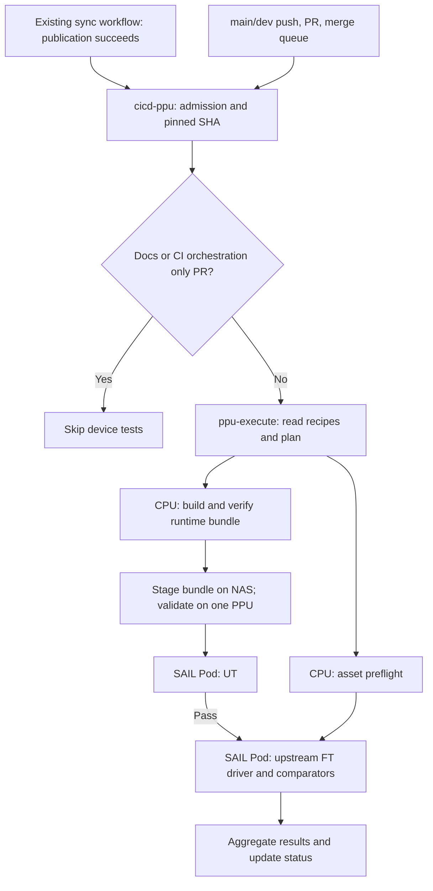

# SAIL PPU CI

English | [中文](ppu-ci.cn.md)

Reuse NVIDIA recipes, UT/FT drivers, and numerical comparators. SAIL maintains
admission and test selection, the platform environment, runner/NAS integration,
M890 golden values, and result aggregation. Model tests remain in the upstream drivers.

## Flow and triggers



- Synchronization keeps the existing candidate-PR flow for main and direct
  publication for dev. After publication, `sync_request` calls `cicd-ppu.yml`
  directly, without relying on a `GITHUB_TOKEN` push to trigger Actions.
- Ordinary pushes, synchronization, and PRs without scope labels run UT quick
  and FT L0 once, with a 30-minute training budget per case. `Run tests` selects
  lightweight observation; `Run functional tests` expands numerical testing to L1.
- Documentation and orchestration-only PRs skip device tests. Image, dependency,
  execution-script, recipe, golden, and model changes still require testing.
  The automatic combined path runs UT before FT and shares the runtime bundle;
  either failure fails the combined result.
- Manual `cicd-ppu.yml` dispatch supports a single UT bucket, FT assets, or FT
  regression. Assets mode does not train; release tags currently run UT only.
  Manual diagnostics use the trusted main/dev branches.
- `ppu-control-tests.yml` runs CPU script regressions for relevant PR paths or
  manual dispatch. It is independent of Build/UT/FT and does not consume PPUs.

`ppu_policy.py` owns the shared policy. `ppu_pr_authorize.py` reads GitHub state,
pins head/base/merge SHAs, and rechecks them after queueing so that stale results
cannot apply to a newer commit. SAIL retains `pull_request_target` without NVIDIA's
copy-pr-bot or runners. Control code comes from a trusted branch; tested code uses
the pinned target SHA.

## Maintenance entry points

Scripts below are under `.github/scripts/` unless a full path is shown. Keep
adaptation limited to platform differences instead of adding a general CI framework.

| Area | Entry points |
|---|---|
| Triggers, authorization, test scope | `ppu_policy.py`, `ppu_pr_authorize.py`; UT quick list `.github/ppu-pr-tests.json` |
| UT | `ppu_ci.py`, `ppu_ci_run.sh`, `ppu_pytest_policy.py`; invoke the upstream UT driver |
| FT selection and execution | `ppu_functional.py`, `ppu_functional_runtime.py`; invoke upstream `run_ci_test.sh` |
| Platform environment | `.github/docker/Dockerfile.ppu-ci`, `ppu_ci_container.py`, `ppu_functional_environment.py` |
| Data and tokenizers | `ppu_ci_paths.py`, `ppu_functional_hf.py`, `.github/ppu-functional-tokenizers.json` |
| Results and logs | `ppu_functional_results.py`, `ppu_functional_pytest.py`, `ppu_ci_export.py` |

Set the repository variable `PPU_CI_ENABLED=true` to enable device jobs; the GitHub
environment is `ppu-ci`. Storage uses the secrets `PPU_HOST_VOLUMES`,
`PPU_CPU_RUN_ROOT`, `PPU_POD_RUN_ROOT`, `PPU_CPU_ASSETS_ROOT`, and
`PPU_POD_ASSETS_ROOT`. CPU and Pod paths must map to the same shared data.
Public artifacts contain JSON reports/metrics, original model configurations,
text logs, and required control scripts, with paths redacted. Other files,
including expanded configurations, TensorBoard data, checkpoints, and caches,
stay on NAS; no separate upload-manifest protocol is needed.

## Runtime delivery and caching

GitHub CPU runners use BuildKit and the SAIL base image to build and offline-verify
a runtime bundle bound to the target and control SHAs. A CPU runner with NAS access
verifies and stages `environment.tar.gz` once. PPU Pods use the fixed SAIL SDK image
resolved to an immutable digest, then verify and extract the shared bundle.
The preparation job validates the environment on one M890P; UT/FT workers retain
their planned device topology. Combined UT/FT runs share the same staged bundle.

The bundle restores source and compiled artifacts to `/opt/ppu-ci-source` and the
Python environment to `/opt/ppu-ci-venv`, separate from the cluster-task workspace
at `/opt/megatron-lm`. Dependencies come from the tested `pyproject.toml` project,
test, and training configuration plus SAIL native-package constraints; the build
does not directly consume NVIDIA's `uv.lock`. Dependency installation and source
compilation happen on CPU during the build, not inside device workers.
Preparation checks dependencies and the UT tokenizer cache; each UT bucket checks
the shared runtime, data delivery, and device visibility before execution.

`Dockerfile.ppu-control` builds the CPU control image, published by Docker's
build-push action. Configure, scheduling, and aggregation jobs use its digest.
Preflight checks dependency versions, imports, launchers, and platform backends.
Upstream UT/FT validate checkpoint, Apex, and other internal API compatibility;
the adapter does not parse their method signatures or maintain implementation maps.

`.github/actions/ppu-build-cache/action.yml` selects registry BuildKit dependency
caches. PRs first read their own matching cache, then the target branch cache.
PR/candidate commits write separate caches; main/dev publication commits update
the baseline. The fingerprint includes the base-image digest, platform, and
dependency build inputs. Source-only changes still compile source while reusing
dependency layers. Caches live in SAIL GHCR. `ppu-populate-build-cache.yml` can warm
them on CPU; it is optional and has no periodic schedule.

## M890 golden values

The path is
`tests/functional_tests/test_cases/<model>/<case>/golden_values_dev_m890.json`.
Use the adjacent `model_config.yaml` by default; add `model_config_m890.yaml` only
for retained platform-parameter differences. Git versions the goldens without a
central baselines JSON or snapshot script.

`m890_model_config()` adapts launchers centrally: torchrun is the default, while
five existing FT-launcher cases retain their launcher. Historical `_2nd.json`
files retain sampling records; checkpoint-resume comparisons use the two stages
of the current run and do not establish fault-injection recovery coverage.
Lightweight observation and missing-asset skips do not count as numerical passes;
missing goldens or failed comparisons cannot silently pass.
Only upstream pytest performs numerical comparisons, including performance warmup
windows and supported metrics. The adapter records input digests and results;
aggregation checks result binding, repetitions, and execution completeness without
rerunning numerical comparison or checking out the tested source.

## Minimum validation

Install the dependencies declared in `ppu-control-tests.yml` in a Python 3.12 CPU
environment; no host GPU environment is needed. For adapter changes, run the
corresponding test files first and the retained regressions before merging:

```bash
python -m pytest -q -o addopts= .github/scripts/tests
```

After deployment, dispatch manual diagnostics from main or dev and select one
case at a time:

```bash
gh workflow run cicd-ppu.yml --repo flytiger-eco/Megatron-LM-for-sail --ref main \
  -f test_kind=functional -f functional_mode=assets -f functional_scope=all \
  -f functional_cases=gpt/gpt3_mcore_te_tp1_pp1_dist_optimizer_no_mmap_bin_files \
  -f functional_repeat=1 -f functional_timeout=15
```

After assets pass, change `functional_mode` to `regression` to request PPUs. This
case runs 50 steps on one eight-card worker. For one UT bucket, use
`test_kind=unit scope=full suite_family=nvidia-dev unit_bucket=tests/unit_tests/test_model_configs.py repeat=1`.
Check UT `failed=0`; for FT, check `numerical_validation=true`, `numeric_passed=1`,
and `numeric_failed=0`. CPU regressions, asset checks, and cache hits do not establish
training accuracy or performance acceptance.

Locate failures by stage: authorize / configure / assets / runtime-environment /
UT / FT. Retain logs and the corresponding SHA. Retry only identified infrastructure
failures within the remaining case budget; do not hide numerical failures with
retries or golden changes. Keep historical debugging records in Git and Actions
rather than accumulating run logs in this maintenance guide.


## Training image build and functional acceptance

`release-docker-ppu-nightly.yml` connects image builds, publication, and device acceptance.
At 16:00 UTC daily it builds SDK 2.2.1 / PyTorch 2.13 from `core_r0.19.0`. Manual dispatch
also supports SDK 2.2.0 and a same-repository source branch or commit. The source must
contain `docker/Dockerfile.sdk.<version>-ppu` from PR #37.

The workflow publishes a `candidate-...` tag containing the complete source SHA, run ID,
and attempt, then runs **that exact published image digest** on eight M890P devices.
Acceptance runs the full 50-step `gpt3_mcore_te_tp1_pp1_dist_optimizer_no_mmap_bin_files`
GPT case once, retaining its distributed optimizer, checkpoint save, TensorBoard extraction,
and upstream pytest comparisons of `lm loss` and `num-zeros`. This is one image acceptance
case, not the entire L0/L1 suite. The source configuration must match the trusted control
revision's M890 reference; incompatible configurations fail before the image build.
The case requests 64 CPUs, 256 GiB of host memory, and 64 GiB of shared memory;
all eight PPUs must be available on the same node.

Training uses the image's entry points and installed Megatron wheel. The workflow does not
overlay training source or replace native dependencies. Only test tools such as pytest/uv
are installed into a temporary venv inheriting the image packages. It reuses existing shared
data, pinned tokenizer caches, and the `sail-ppu-hardware` execution queue. Incomplete training,
skipped/failed pytest checks, and missing evidence fail acceptance. Reports and logs pass
through the existing redaction exporter; checkpoints remain on shared storage.

The registry remains `ghcr.io/flytiger-eco/megatron-lm-ppu-nightly`:

- `candidate-sdk<version>-<full-SHA>-<run_id>-<attempt>`: built candidate, possibly not yet accepted.
- `core_r0.19.0-sdk<version>`: rolling tag updated only after successful FT.
- `nightly`: accepted SDK 2.2.1 default image.

Manual `push=true` publishes a candidate and runs FT; `push=false` builds only.
`promote` defaults to false. Manual promotion requires the workflow to run from the default
branch with `source_ref=core_r0.19.0` and successful FT. Scheduled runs promote automatically.
Failed FT leaves the candidate available for diagnosis without changing rolling tags.

```bash
gh workflow run release-docker-ppu-nightly.yml   --repo flytiger-eco/Megatron-LM-for-sail --ref main   -f source_ref=core_r0.19.0 -f sdk=2.2.1 -f push=true -f promote=true
```
