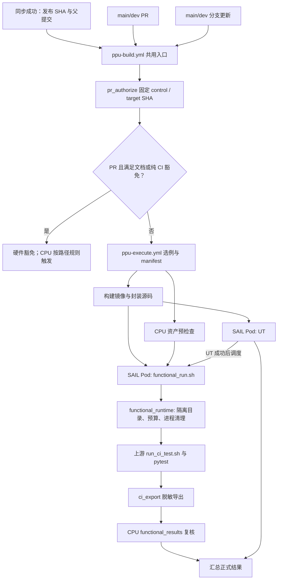

# SAIL PPU CI 维护

本分支聚焦正式 PPU CI：复用上游训练脚本与比较器，在 SAIL runner 上执行。
维护提交统一使用 `DavidSophus <95245426@qq.com>`。历史专项诊断和本地调试工具
已移出交付内容。

## 同步与 PR 的统一入口

代码同步沿用主线已有的 Copilot 同步流程；这里仅增加发布结果与测试流水线的交接。
main 发布同步候选分支并创建 PR，dev 直接发布到 dev；原有合并和冲突处理逻辑不变。
同步发布成功后，worker 输出 `sync_request`（被测 SHA、两个父提交、发布分支），
父 workflow 直接调用 `ppu-build.yml` 的 `workflow_call`，再复用同一套 Build→UT→FT。
不依赖 `GITHUB_TOKEN` 的 push 触发后续 Actions。main 和 dev 的 artifacts、NAS 目录分别使用
`sync-main-` / `sync-dev-` 前缀，共享仓库级 `sail-ppu-hardware` 串行队列。
排队的 PR 在进入设备前重新检查 head/base 和状态归属。测试失败不会回滚已发布的 dev 同步提交。
没有新提交、仅 dry-run 或发布失败时，不输出交接请求，也不启动同步后的硬件测试。

普通分支更新、同步及无标签 PR 共用 UT 的 `quick` 范围；FT 默认使用相同的上游 L0 测试集、一次重复、30 分钟预算。
其中上游标注为 lightweight 的 case 只记录观察结果，不计为数值精度通过；其余 case 使用正式 golden 比较。
`Run tests` 保留显式轻量观察模式，`Run functional tests` 可扩大到 L1；常规路径不需要标签。
文档和纯 CI 编排 PR 可豁免硬件测试，CPU 检查按各 workflow 的路径规则触发；
执行器、镜像/依赖、recipe、golden、被测代码变更仍运行硬件测试。同步与普通 push 不做路径豁免。
改名同时检查原路径，变更列表不完整时不豁免。

GitHub 自 2025-12-08 起从默认分支加载 `pull_request_target`，即使 PR 合入 dev，控制代码仍来自 main。
因此入口用 PR 的 `base.ref` 判断目标分支，用默认分支 SHA 固定控制代码。
自动 PR 事件入口必须在 main 上线后验收；历史独立分支验证使用真实 PR 的 full-SHA 手动授权。
参考：[GitHub 变更说明](https://github.blog/changelog/2025-11-07-actions-pull_request_target-and-environment-branch-protections-changes/)。

正式入口只信任 main/dev；临时测试分支、同步模拟交接和专用组合 smoke 模式不进入正式控制代码。
已有集成测试分支保留这些验证工具和历史记录；后续改动先运行 CPU 控制测试，再按需选择单个设备 case。

dev 的 UT recipe 目前还包含 `examples/multimodal_dev/tests` 和 2/4 卡分组。
选择器直接读取 recipe 的 `gpus`，GTP bucket 按上游脚本显式设置的 `GPUS_PER_NODE=4` 执行；
这条例外集中在 `ppu_policy.py`。新增测试根目录、超出单机 1/2/4/8 卡的拓扑会在 CPU 选例阶段报错。
NVRx 预检查同时支持旧 `get_async_strategy()` 与 dev 的直接 NVRx 接口，环境报告记录 `source_api`。
两条路径均检查上游能力和原始 API 签名，不创建 checkpoint worker，也不因接口变化跳过检查。
构建阶段的推理通信预检查也集中在 `ppu_functional_environment.py`：根据实际 engine 类的来源，
检查旧 `dynamic_engine` 或 dev 拆分后的 `dynamic.coordinator` 中的 ZMQ/MessagePack 能力；
未知布局和缺少能力均失败，日志记录本轮检查的模块。

## 执行路径



combined 流程仅在 UT 成功后启动 functional；最终组合结果要求 UT 和 functional 都成功。
`control_sha` 标识控制代码，`target_sha` 标识被测源码；训练 PR 在旧 control 下通过，
不能证明该 PR 修改的 CI 脚本已被执行。新控制代码需要单独的 CPU 验证和开发环境验证，
不能为此放开正式授权规则。
FT 的 scope、cadence 和预算来自 control 中受信任的 recipe；被测分支的 recipe 可以是另一版本。
manifest 的 `control_files`、`source_files` 分别记录两者摘要，case 的 `recipe_sha256` 对应被测源码。
执行前仍逐项验证 source；不能拿 main/control 的摘要要求 dev/source 文件相同。

## 保留的脚本与责任

以下文件均位于 `.github/scripts/`。CPU 测试在其 `tests/test_ppu_*.py` 下。

| 文件 | 维护职责 |
|---|---|
| `ppu_policy.py` | 受信任分支、CPU 豁免路径、UT 拓扑例外和同步产物前缀 |
| `ppu_pr_authorize.py` | 授权、SHA、过期状态与 PR 状态归属 |
| `ppu_ci.py`、`ppu_pytest_policy.py` | UT 选例、manifest、排除策略、结果门槛和证据 |
| `ppu_ci_build.sh`、`ppu_ci_run.sh` | 构建准备和 UT 执行 |
| `ppu_ci_container.py`、`.sh` | 镜像指纹、构建、导出/恢复和产物校验 |
| `ppu_ci_paths.py`、`ppu_ci_export.py` | CPU/Pod 存储映射与公共产物脱敏 |
| `ppu_functional.py` | recipe/golden 选择、计划与资产清单 |
| `ppu_functional_snapshot.py` | baseline 配置和 golden 的 SHA256 清单 |
| `ppu_functional_hf.py` | 固定版本 tokenizer、receipt 与离线缓存 |
| `ppu_functional_environment.py` | 包/API/工具/设备/编译环境检查 |
| `ppu_functional_run.sh` | 正式 Pod 执行入口：镜像、环境、runtime |
| `ppu_functional_runtime.py` | 上游 shell 调用、重复/预算/重试、进程族清理 |
| `ppu_functional_pytest.py`、`ppu_functional_results.py` | pytest 证据记录及完整结果复核 |

进程族发现与信号清理函数现位于 runtime 内，不依赖诊断脚本；保留跨 session、孤儿进程、
PID 重用、超时、取消和实际子进程清理测试。正常日志、错误分类、环境检查不属于可删除的
临时 debug 内容。模型配置、golden、比较器及正式门槛未随此次清理修改。

维护时先按失败阶段定位，避免重跑整套硬件测试：

| 失败位置 / 证据 | 首先检查什么 | 负责文件 |
|---|---|---|
| authorize / `authorization.json` | PR 状态、head/base SHA、调用 workflow、是否属于 CPU 豁免路径 | `ppu_pr_authorize.py`、`ppu_policy.py` |
| configure / `manifest.json`、`functional-manifest.json` | 上游 recipe 变化、被选 case、拓扑、baseline/tokenizer 锁定文件 | `ppu_ci.py`、`ppu_functional.py` |
| runtime-environment / Docker 构建日志 | 基础镜像 digest、包约束、离线安装与编译 | `Dockerfile.ppu-ci`、`ppu_ci_container.py` |
| functional-assets / `assets-report.json` | NAS 映射、数据文件、tokenizer receipt 与缓存 | `ppu_ci_paths.py`、`ppu_functional_hf.py` |
| build / Pod 状态与构建日志 | 先区分排队、镜像拉取、实际执行，再检查包导入、设备接口与构建产物 | `ppu_ci_build.sh`、`ppu_functional_environment.py` |
| UT Gate / `summary.json` | 实际执行数、failed/skipped、失败方法与各 rank 日志 | `ppu_ci.py`、`ppu_pytest_policy.py` |
| Functional gate / `failure_categories`、`execution.json`、`pytest-regular.json` | 训练退出、比较器结果、证据是否完整、case 预算 | `ppu_functional_runtime.py`、`ppu_functional_results.py` |

只有 `infrastructure_retryable` 可在剩余预算内自动重试；数值不一致、OOM、导入失败、证据错误
不会通过反复重跑变成通过。`observation` 也不会加入 numeric 通过率。修改单个控制模块后，
先运行对应的 CPU 测试文件；完整控制回归的依赖与命令以 `ppu-control-tests.yml` 为准。

## 最小验证顺序

先在具备 Python 3.12 和 `.github/docker/control-requirements.txt` 依赖的 CPU 环境中检查。
不要为控制脚本在宿主机安装 Megatron GPU 依赖或同步整个项目环境。
`ppu-control-tests.yml` 在面向 main/dev 的相关路径 PR 上运行，也支持手动调度；它只使用 CPU。

```bash
# 只验证选例与锁定文件，不申请 Pod，也不检查 NAS 是否可读。
PPU_INPUTS='{"functional_cases":"gpt/gpt3_mcore_te_tp1_pp1_dist_optimizer_no_mmap_bin_files"}' \
  python .github/scripts/ppu_functional.py catalogue > /tmp/ppu-catalogue.json

# 控制脚本回归；训练与数值检查使用合成证据，不占用 PPU。
PYTEST_DISABLE_PLUGIN_AUTOLOAD=1 python -m pytest -q \
  .github/scripts/tests/test_ppu_functional.py \
  .github/scripts/tests/test_ppu_functional_runtime.py \
  .github/scripts/tests/test_ppu_functional_results.py
```

需要 NAS 或设备验证时，在 `ppu-build.yml` 的受信任分支上手动选择下列输入。
功能测试控制 Build/UT，其他 UT 开关保持默认值；不要提交 `all` 个 case。

| 输入 | 首先检查资产 | 确需训练时 |
|---|---|---|
| `test_kind` | `functional` | `functional` |
| `functional_mode` | `assets` | `regression` |
| `functional_scope` | `all`（由下列精确 case 再过滤） | 同左 |
| `functional_cases` | `gpt/gpt3_mcore_te_tp1_pp1_dist_optimizer_no_mmap_bin_files` | 同左 |
| `functional_repeat` | `1` | `1` |
| `functional_timeout` | `5` | `5` 分钟总训练预算 |

这个普通 GPT case 为 TP1/PP1、12 层、hidden size 512、50 步；选择它是为了减少特性组合，
不是声称它已经实测最快。需要数据、vocab/merges 和固定的 GPT2 tokenizer 缓存。
现有执行器仍要求单机 **8 卡**。`repeat=1` 不关闭正式基础设施重试：最多 3 次 attempt
共用预算；排队、构建、资产预检查和退出清理另有开销。冷编译可能耗尽预算，不能据此判精度失败。

仅定位 UT 时，使用已有的单 bucket 入口；下面命令在本流程上线后从 main 调度：

```bash
gh workflow run ppu-build.yml --repo flytiger-eco/Megatron-LM-for-sail \
  --ref main -f test_kind=unit -f scope=full -f suite_family=nvidia-dev \
  -f unit_bucket=tests/unit_tests/test_model_configs.py -f repeat=1
```

单 bucket 与单 FT case 是独立诊断请求，各自构建；都不能发布 PR 成功状态，也不代表完整覆盖。
历史共享构建的组合 smoke 工具保留在集成测试分支，运行时必须核对该版本的 control/target SHA。

已有正式产物直接在 CPU 复核，不重跑训练：

```bash
python .github/scripts/ppu_functional_results.py \
  --manifest /path/to/manifest.json --root /path/to/target --results /path/to/results
```

结果目录保留 `functional-000/` 等子目录中的原始环境、action、rank、pytest、TensorBoard
和导出证据。先定位失败阶段，再选择一个相关 case。`ckpt-resume` 检查保存/加载，不能证明
故障注入后的自动恢复；一次 numeric 或 smoke 也不能证明性能稳定。

## 独立分支验证记录（2026-11-20）

以下均为 GitHub Actions 上的实际执行。CPU 控制测试与 PPU 训练证据分开记录，正式 main/dev 未写入测试提交。

| 验证 | 代码 / 运行记录 | 结果与边界 |
|---|---|---|
| CPU 控制回归 | `b9fdbe4b8`；[44601645148](https://github.com/flytiger-eco/Megatron-LM-for-sail/actions/runs/44601645148) | 1,842 passed；覆盖授权、路径、选例、产物、比较与清理逻辑，不代表训练通过 |
| 草稿 PR | [44571365750](https://github.com/flytiger-eco/Megatron-LM-for-sail/actions/runs/44571365750) | 保持 pending，不构建、不申请 PPU |
| 文档 PR | [44572021070](https://github.com/flytiger-eco/Megatron-LM-for-sail/actions/runs/44572021070) | 按策略豁免硬件测试 |
| 纯 CI PR | `506307b1d` 控制；[44577131713](https://github.com/flytiger-eco/Megatron-LM-for-sail/actions/runs/44577131713) | 明确发布 Docs/CI-only 豁免状态；构建和执行 job 跳过 |
| main 源码最小流程 | control / target 均为 `069979312`；[44571681281](https://github.com/flytiger-eco/Megatron-LM-for-sail/actions/runs/44571681281) | UT：816 passed、0 failed、213 skipped；FT：1 个 numeric case 通过，1 attempt / 1 repeat；组合结果 success |
| dev 跨分支校验修复前 | control `cdc427722` / target `b88d6d178`；[44593647743](https://github.com/flytiger-eco/Megatron-LM-for-sail/actions/runs/44593647743) | 构建成功，UT：244 passed、0 failed、67 skipped；FT 在训练前被 recipe 摘要混用问题拦截。已在 `b9fdbe4b8` 修复并用真实 dev 文件在 CPU 复现验证；此轮不算精度通过 |
| dev 源码最小流程 | control `b9fdbe4b8` / target `891c690a2`；[44602771487](https://github.com/flytiger-eco/Megatron-LM-for-sail/actions/runs/44602771487) | UT：244 passed、0 failed、67 skipped；FT：1 个 numeric case 通过，1 attempt / 1 repeat；100% numeric gate 与组合结果 success |

临时 PR [#21](https://github.com/flytiger-eco/Megatron-LM-for-sail/pull/21) 已关闭，未合并。
PR 探针使用真实 PR 的 head/base SHA 手动授权；不能将它们写成自动 `pull_request_target` 事件已验收。

历史生产同步 [44563433346](https://github.com/flytiger-eco/Megatron-LM-for-sail/actions/runs/44563433346)
曾在创建 main 同步 PR 时被仓库设置拒绝（`GitHub Actions is not permitted to create or approve pull requests`）。
集成验证没有修改仓库设置或凭据；正式发布权限以实际同步运行结果为准，不能用沙箱接线结果替代。

main 最小运行的首次镜像拉取耗时 20 分 2 秒（压缩镜像约 7.11 GiB），实际构建检查 78 秒。
UT 设备内执行 55 秒，FT 训练与比较约 184 秒。各项计时口径不同，不应相加作为稳定性能指标；
冷启动开销与训练性能分别记录。此运行不覆盖完整 L0、checkpoint resume、FT 故障注入或性能回归。

dev 成功运行的设备内构建检查为 75 秒，FT 训练与比较约 197 秒，Pod 内完整执行 209 秒。
同样只代表单次最小诊断，不作为 main/dev 性能对比。原始环境报告确认使用 dev 的 `direct_nvrx`
接口与新的推理通信模块；配置、golden、数值门槛和依赖版本均未为这轮通过而改动。
最终文档提交只补充说明，实际硬件证据以表中 control/target SHA 为准。
测试引用和复跑方法参见
[集成测试分支的历史说明](https://github.com/flytiger-eco/Megatron-LM-for-sail/blob/40f53fed83b0007f0f2251460a20d07858b920c2/docs/developer/ppu-ci.md)。
这些记录仅证明表中提交的最小流程；新的 main/dev 提交需要重新验证。

## 维护约定

我们分别维护平台环境、测试控制、模型基线、发布门禁；变更附对应的环境报告、CPU 测试、
采样证据或 control/target 身份。长期 CODEOWNERS 沿用项目真实授权关系，不虚构维护账号。
四项交付以此说明、现有最小调用方式、CPU 自验证和责任边界为基础逐步完善。

项目依赖由 `pyproject.toml` / `uv.lock` 管理；PPU CI 使用独立的平台环境：Dockerfile 读取被测源码的
project dependencies、test dependency group 和 training extra，再叠加 SAIL 原生包约束与测试工具。
它不会直接执行整个 NV dev extra 的 `uv sync`。CPU 控制解释器使用 `control-requirements.txt`，
tokenizer 则由固定 revision、文件摘要和 receipt 管理。产品镜像 `docker/Dockerfile.ppu` 另有用途。

同一次流水线通过镜像 digest、安装报告、编译产物与环境摘要保证 Build / UT / FT 使用同一环境。
这不等于所有传递依赖都已完全锁定：清空构建缓存后的解析结果仍需检查安装报告，并单独验证升级。
禁止通过现场 pip 修复或改 golden 掩盖失败。历史 `_2nd.json` 保留采样来源；resume 比较本次
第一阶段与恢复阶段。以后清理重复配置或依赖漂移，应另立小改动验证。

本地 CPU 验证不代表远程 Linux runner、SAIL 训练、精度或性能验收；硬件验证单独记录。

## 构建缓存与 NV 对齐

设备测试仍先执行 runtime-environment 的构建和离线镜像验证，再以镜像 digest 交给 Build / UT / FT。
依赖层使用 BuildKit registry cache，存放在 `ghcr.io/flytiger-eco/megatron-lm-for-sail/ppu-ci`，
构建运行在 `ubuntu-latest`，基础镜像来自 SAIL 的 `pkg.flytiger-eco.com`；不使用 NVIDIA runner 或缓存仓库。
CPU 控制解释器体积较小，继续使用原有 GitHub Actions cache。

维护入口为 `.github/actions/ppu-build-cache/action.yml`（选择缓存）、
`ppu_ci_container.py build_identity/build`（指纹与 Docker 构建）、
`Dockerfile.ppu-ci` 的 `dependencies` stage（实际依赖）。没有另加 Python 缓存脚本。
依赖指纹包含不可变基础镜像 digest、平台、Docker 构建文件和被测 `pyproject.toml`；
普通源码、提交 SHA、控制脚本及仅供控制解释器使用的 requirements 不改变运行时依赖指纹。
控制与源码身份仍绑定最终镜像；源码扩展继续单独编译。当前依赖安装未消费 `uv.lock`，
因此不能把这一改动描述成已采用 NV 的完整依赖锁定方案。

| 运行来源 | 优先读取 | 写入 |
| --- | --- | --- |
| PR | 本 PR 同指纹 → 目标分支同指纹 → 目标分支 baseline | 本 PR 同指纹 |
| main/dev 已发布提交 | 目标分支同指纹 → 目标分支 baseline | 目标分支 baseline |
| 合并队列或 main 同步候选 | 候选同指纹 → 目标分支同指纹 → 目标分支 baseline | 候选同指纹 |
| 显式 CPU 预热 | 目标分支同指纹 → 目标分支 baseline | 目标分支同指纹 |

只导出 `dependencies` stage 的缓存。缓存只是加速输入，BuildKit 会继续核对各层；
Actions summary 显示选中的读取、写入位置，选中 donor 不代表每层都命中。
相比 NV，这里没有历史 registry cache 的兼容回退，因为原实现使用 GitHub Actions cache。

`ppu-populate-build-cache.yml` 在 main/dev 的构建输入变化时或手动触发，只构建依赖层，不申请 PPU，
也不执行目标源码、UT 或 FT。为控制资源开销，不设置每六小时定时预热。
已有同步流程用 `GITHUB_TOKEN` 推送 dev 时不会再次触发 push workflow；同步后正常 runtime build
已能更新 baseline，不需要新增同步接线。新 workflow 合入后可从 main/dev 手动预热。
实际缓存命中率、CPU 耗时和镜像拉取耗时，需要在线 Docker/GHCR 运行记录验收；CPU 单测不替代此项。
