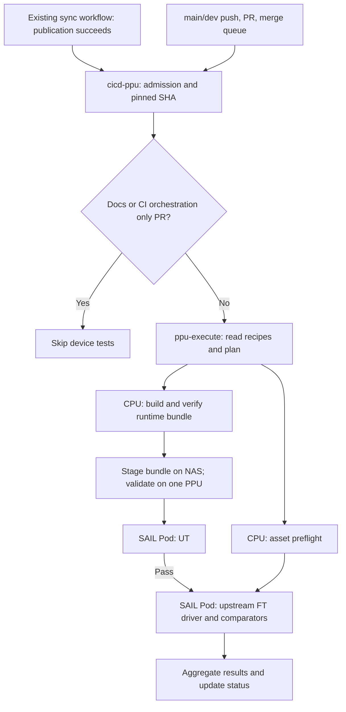
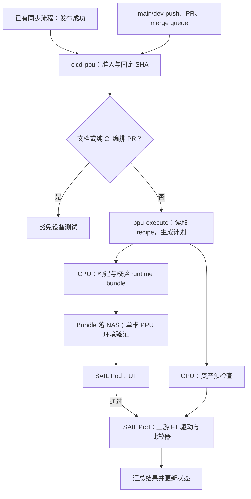

# SAIL PPU CI

[English](#english) | [中文](#中文)

## English

Reuse NVIDIA recipes, UT/FT drivers, and numerical comparators. SAIL maintains
admission and test selection, the platform environment, runner/NAS integration,
M890 golden values, and result aggregation. Model tests remain in the upstream drivers.

### Flow and triggers



- Synchronization keeps the existing candidate-PR flow for main and direct
  publication for dev. After publication, `sync_request` calls `cicd-ppu.yml`
  directly, without relying on a `GITHUB_TOKEN` push to trigger Actions.
- Ordinary pushes, synchronization, and PRs without scope labels run UT quick
  and FT L0 once, with a 30-minute training budget per case. `Run tests` selects
  lightweight observation; `Run functional tests` expands numerical testing to L1.
- Documentation and orchestration-only PRs skip device tests. Image, dependency,
  execution-script, recipe, golden, and model changes still require testing.
  The automatic combined path runs UT before FT and shares the runtime bundle;
  either failure fails the combined result.
- Manual `cicd-ppu.yml` dispatch supports a single UT bucket, FT assets, or FT
  regression. Assets mode does not train; release tags currently run UT only.
  Manual diagnostics use the trusted main/dev branches.
- `ppu-control-tests.yml` runs CPU script regressions for relevant PR paths or
  manual dispatch. It is independent of Build/UT/FT and does not consume PPUs.

`ppu_policy.py` owns the shared policy. `ppu_pr_authorize.py` reads GitHub state,
pins head/base/merge SHAs, and rechecks them after queueing so that stale results
cannot apply to a newer commit. SAIL retains `pull_request_target` without NVIDIA's
copy-pr-bot or runners. Control code comes from a trusted branch; tested code uses
the pinned target SHA.

### Maintenance entry points

Scripts below are under `.github/scripts/` unless a full path is shown. Keep
adaptation limited to platform differences instead of adding a general CI framework.

| Area | Entry points |
|---|---|
| Triggers, authorization, test scope | `ppu_policy.py`, `ppu_pr_authorize.py`; UT quick list `.github/ppu-pr-tests.json` |
| UT | `ppu_ci.py`, `ppu_ci_run.sh`, `ppu_pytest_policy.py`; invoke the upstream UT driver |
| FT selection and execution | `ppu_functional.py`, `ppu_functional_runtime.py`; invoke upstream `run_ci_test.sh` |
| Platform environment | `.github/docker/Dockerfile.ppu-ci`, `ppu_ci_container.py`, `ppu_functional_environment.py` |
| Data and tokenizers | `ppu_ci_paths.py`, `ppu_functional_hf.py`, `.github/ppu-functional-tokenizers.json` |
| Results and logs | `ppu_functional_results.py`, `ppu_functional_pytest.py`, `ppu_ci_export.py` |

Set the repository variable `PPU_CI_ENABLED=true` to enable device jobs; the GitHub
environment is `ppu-ci`. Storage uses the secrets `PPU_HOST_VOLUMES`,
`PPU_CPU_RUN_ROOT`, `PPU_POD_RUN_ROOT`, `PPU_CPU_ASSETS_ROOT`, and
`PPU_POD_ASSETS_ROOT`. CPU and Pod paths must map to the same shared data.
Public artifacts contain JSON reports/metrics, original model configurations,
text logs, and required control scripts, with paths redacted. Other files,
including expanded configurations, TensorBoard data, checkpoints, and caches,
stay on NAS; no separate upload-manifest protocol is needed.

### Runtime delivery and caching

GitHub CPU runners use BuildKit and the SAIL base image to build and offline-verify
a runtime bundle bound to the target and control SHAs. A CPU runner with NAS access
verifies and stages `environment.tar.gz` once. PPU Pods use the fixed SAIL SDK image
resolved to an immutable digest, then verify and extract the shared bundle.
The preparation job validates the environment on one M890P; UT/FT workers retain
their planned device topology. Combined UT/FT runs share the same staged bundle.

The bundle restores source and compiled artifacts to `/opt/ppu-ci-source` and the
Python environment to `/opt/ppu-ci-venv`, separate from the cluster-task workspace
at `/opt/megatron-lm`. Dependencies come from the tested `pyproject.toml` project,
test, and training configuration plus SAIL native-package constraints; the build
does not directly consume NVIDIA's `uv.lock`. Dependency installation and source
compilation happen on CPU during the build, not inside device workers.
Preparation checks dependencies and the UT tokenizer cache; each UT bucket checks
the shared runtime, data delivery, and device visibility before execution.

`Dockerfile.ppu-control` builds the CPU control image, published by Docker's
build-push action. Configure, scheduling, and aggregation jobs use its digest.
Preflight checks dependency versions, imports, launchers, and platform backends.
Upstream UT/FT validate checkpoint, Apex, and other internal API compatibility;
the adapter does not parse their method signatures or maintain implementation maps.

`.github/actions/ppu-build-cache/action.yml` selects registry BuildKit dependency
caches. PRs first read their own matching cache, then the target branch cache.
PR/candidate commits write separate caches; main/dev publication commits update
the baseline. The fingerprint includes the base-image digest, platform, and
dependency build inputs. Source-only changes still compile source while reusing
dependency layers. Caches live in SAIL GHCR. `ppu-populate-build-cache.yml` can warm
them on CPU; it is optional and has no periodic schedule.

### M890 golden values

The path is
`tests/functional_tests/test_cases/<model>/<case>/golden_values_dev_m890.json`.
The name follows the upstream `golden_values_<environment>_<platform>.json`
convention in the [H100 GPT recipe](../../tests/test_utils/recipes/h100/gpt.yaml).

| Name component | Meaning |
|---|---|
| `golden_values` | Reference metrics used by the numerical comparator |
| `dev` | Upstream DEV test-environment identifier, paired with `lts` for the LTS environment |
| `m890` | SAIL M890 platform identifier for these reference measurements |

For example, NVIDIA's DEV/H100 file is `golden_values_dev_dgx_h100.json`.
The upstream launcher exposes `--environment dev|lts` as the PyTorch DEV/LTS choice.
In the upstream code included here, the GitHub H100/GB200 FT jobs explicitly pass
`--environment dev`; the GitLab configuration has separate DEV and LTS paths.
The recipe resolves `GOLDEN_VALUES_PATH`, which `run_ci_test.sh` passes to pytest.
See [`cicd-main.yml`](../../.github/workflows/cicd-main.yml) and
[`04.functional-tests.yml`](../../.gitlab/stages/04.functional-tests.yml).

`dev` identifies an environment family, not the Git branch, a draft baseline, or
the L0/L1 test scope. In SAIL, `load_recipes()` explicitly selects `dev` recipes and
`describe_case()` selects `golden_values_dev_m890.json`; see
[`ppu_functional.py`](../../.github/scripts/ppu_functional.py).
Both main and dev therefore use the DEV/M890 reference for the selected case;
the branch name does not switch FT golden files. SAIL currently has no separate
LTS FT golden-selection path. Its actual runtime is the fixed SAIL SDK image and
verified bundle described above; the `dev` filename does not select an NVIDIA image.
Git records baseline revisions, so the filename is not a commit or SDK version.
Keep the convention to preserve alignment with upstream recipes and existing assets.

Use the adjacent `model_config.yaml` by default; add `model_config_m890.yaml` only
for retained platform-parameter differences. Git versions the goldens without a
central baselines JSON or snapshot script.

`m890_model_config()` adapts launchers centrally: torchrun is the default, while
five existing FT-launcher cases retain their launcher. Historical `_2nd.json`
files retain sampling records; checkpoint-resume comparisons use the two stages
of the current run and do not establish fault-injection recovery coverage.
Lightweight observation and missing-asset skips do not count as numerical passes;
missing goldens or failed comparisons cannot silently pass.
Only upstream pytest performs numerical comparisons, including performance warmup
windows and supported metrics. The adapter records input digests and results;
aggregation checks result binding, repetitions, and execution completeness without
rerunning numerical comparison or checking out the tested source.

### Minimum validation

Install the dependencies declared in `ppu-control-tests.yml` in a Python 3.12 CPU
environment; no host GPU environment is needed. For adapter changes, run the
corresponding test files first and the retained regressions before merging:

```bash
python -m pytest -q -o addopts= .github/scripts/tests
```

After deployment, dispatch manual diagnostics from main or dev and select one
case at a time:

```bash
gh workflow run cicd-ppu.yml --repo flytiger-eco/Megatron-LM-for-sail --ref main \
  -f test_kind=functional -f functional_mode=assets -f functional_scope=all \
  -f functional_cases=gpt/gpt3_mcore_te_tp1_pp1_dist_optimizer_no_mmap_bin_files \
  -f functional_repeat=1 -f functional_timeout=15
```

After assets pass, change `functional_mode` to `regression` to request PPUs. This
case runs 50 steps on one eight-card worker. For one UT bucket, use
`test_kind=unit scope=full suite_family=nvidia-dev unit_bucket=tests/unit_tests/test_model_configs.py repeat=1`.
Check UT `failed=0`; for FT, check `numerical_validation=true`, `numeric_passed=1`,
and `numeric_failed=0`. CPU regressions, asset checks, and cache hits do not establish
training accuracy or performance acceptance.

Locate failures by stage: authorize / configure / assets / runtime-environment /
UT / FT. Retain logs and the corresponding SHA. Retry only identified infrastructure
failures within the remaining case budget; do not hide numerical failures with
retries or golden changes. Keep historical debugging records in Git and Actions
rather than accumulating run logs in this maintenance guide.

## 中文

复用 NVIDIA recipe、UT/FT 驱动和数值比较器。SAIL 只维护准入与选例、平台环境、
runner/NAS 接线、M890 golden 和结果汇总；不在适配层重新实现模型测试。

### 流程与触发



- 同步沿用现有 main 候选 PR / dev 直接发布机制。发布后通过 `sync_request`
  调用 `cicd-ppu.yml`，无需依赖 `GITHUB_TOKEN` push 再触发 Actions。
- 普通 push、同步和无标签 PR：UT quick、FT L0、运行一次、每 case 30 分钟训练预算。
  `Run tests` 选择轻量观察，`Run functional tests` 扩大数值测试到 L1。
- 文档和纯编排 PR 豁免设备；镜像、依赖、执行脚本、recipe、golden 和模型代码仍需测试。
  自动 combined 路径先 UT 后 FT，共用 runtime bundle；任一失败则组合失败。
- 手动 `cicd-ppu.yml` 支持单 UT bucket、FT assets 或 regression。assets 不训练；
  release tag 当前只执行 UT。手动诊断使用受信任的 main/dev 分支。
- `ppu-control-tests.yml` 是独立的 CPU 脚本回归，只在相关路径 PR 或手动运行时执行，
  不是每次 Build/UT/FT 的前置 job，也不消耗 PPU。

`ppu_policy.py` 集中维护规则；`ppu_pr_authorize.py` 读取 GitHub 状态、固定 head/base/merge SHA，
并在排队后复查，防止旧提交的结果用于新提交。SAIL 保留 `pull_request_target` 入口，
没有接入 NVIDIA copy-pr-bot 或 NVIDIA runner。控制代码来自受信任分支，被测代码使用固定的 target SHA。

### 维护入口

下表脚本均在 `.github/scripts/`，完整路径除外；只为实际平台差异保留适配，不增加通用 CI 框架。

| 内容 | 入口 |
|---|---|
| 触发、权限、测试范围 | `ppu_policy.py`、`ppu_pr_authorize.py`；UT quick 清单 `.github/ppu-pr-tests.json` |
| UT | `ppu_ci.py`、`ppu_ci_run.sh`、`ppu_pytest_policy.py`，调用上游 UT 驱动 |
| FT 选例与运行 | `ppu_functional.py`、`ppu_functional_runtime.py`，调用上游 `run_ci_test.sh` |
| 平台环境 | `.github/docker/Dockerfile.ppu-ci`、`ppu_ci_container.py`、`ppu_functional_environment.py` |
| 数据与 tokenizer | `ppu_ci_paths.py`、`ppu_functional_hf.py`、`.github/ppu-functional-tokenizers.json` |
| 结果与日志 | `ppu_functional_results.py`、`ppu_functional_pytest.py`、`ppu_ci_export.py` |

仓库变量 `PPU_CI_ENABLED=true` 开启设备流程；GitHub environment 使用 `ppu-ci`。
存储接线使用 secrets：`PPU_HOST_VOLUMES`、`PPU_CPU_RUN_ROOT`、`PPU_POD_RUN_ROOT`、
`PPU_CPU_ASSETS_ROOT`、`PPU_POD_ASSETS_ROOT`。CPU 与 Pod 路径必须映射到同一共享数据。
公共 artifacts 只导出 JSON 报告/指标、原始模型配置、文本日志及必要的控制脚本，并脱敏路径。
其余文件（含展开配置、TensorBoard、checkpoint 和缓存）保留 NAS；不另建上传文件清单协议。

### 运行环境交付与缓存

GitHub CPU runner 使用 BuildKit 和 SAIL 基础镜像，构建并离线验证绑定 target/control SHA 的
runtime bundle。可访问 NAS 的 CPU runner 校验并一次性暂存 `environment.tar.gz`。
PPU Pod 使用解析为不可变 digest 的固定 SAIL SDK 镜像，再校验、解压共享 bundle。
准备阶段使用单张 M890P 验证环境；UT/FT worker 保留计划中的设备拓扑。
combined UT/FT 共用已暂存的 bundle。

Bundle 将源码和编译产物还原到 `/opt/ppu-ci-source`，将 Python 环境还原到
`/opt/ppu-ci-venv`，与 cluster-task 工作区 `/opt/megatron-lm` 分开。
依赖来自被测 `pyproject.toml` 的 project/test/training 配置及 SAIL 原生包约束，
当前不直接消费 NVIDIA `uv.lock`。依赖安装与源码编译在 CPU 构建阶段完成，设备 worker 内不现场安装。
准备阶段检查依赖和 UT tokenizer 缓存；各 UT bucket 验证共享运行环境、数据交付及设备可见性后运行。

CPU 控制环境由 `Dockerfile.ppu-control` 构建，经 Docker 官方 build-push action 发布；
配置、调度和汇总 jobs 按 digest 使用同一控制镜像。
预检查确认依赖版本、导入、launcher 和平台后端；checkpoint、Apex 等上游内部 API 的
调用兼容性由原始 UT/FT 验证，适配层不解析其内部方法签名或维护实现位置映射。

`.github/actions/ppu-build-cache/action.yml` 选择 registry BuildKit 依赖缓存：
PR 优先读自己的同指纹缓存，再读目标分支；PR/候选提交分别写独立缓存，main/dev 发布提交更新 baseline。
指纹由基础镜像 digest、平台和依赖构建输入决定；普通源码变化仍编译源码，但可以复用依赖层。
缓存存放于 SAIL GHCR。`ppu-populate-build-cache.yml` 可在 CPU 上预热，
不是每个 PR 的必需步骤，也不设置周期性预热。

### M890 golden

使用 `tests/functional_tests/test_cases/<model>/<case>/golden_values_dev_m890.json`。
文件名沿用上游 `golden_values_<environment>_<platform>.json` 约定，见
[H100 GPT recipe](../../tests/test_utils/recipes/h100/gpt.yaml)。

| 文件名组成 | 含义 |
|---|---|
| `golden_values` | 数值比较器使用的参考指标 |
| `dev` | 上游 DEV 测试环境标识，与 LTS 环境的 `lts` 对应 |
| `m890` | 这组参考测量值所属的 SAIL M890 平台标识 |

例如 NVIDIA 的 DEV/H100 文件是 `golden_values_dev_dgx_h100.json`。
上游 launcher 的 `--environment dev|lts` 对应 PyTorch DEV/LTS 环境选择。
本仓库包含的上游代码中，GitHub 的 H100/GB200 FT job 显式传入 `--environment dev`；
GitLab 配置则分别有 DEV 和 LTS 路径。recipe 解析出 `GOLDEN_VALUES_PATH`，
再由 `run_ci_test.sh` 传给 pytest，见 [`cicd-main.yml`](../../.github/workflows/cicd-main.yml)
和 [`04.functional-tests.yml`](../../.gitlab/stages/04.functional-tests.yml)。

`dev` 表示环境类别，不是 Git 分支名、草稿基线或 L0/L1 测试范围。
SAIL 适配层的 `load_recipes()` 显式筛选 `dev` recipe，`describe_case()` 选择
`golden_values_dev_m890.json`，见 [`ppu_functional.py`](../../.github/scripts/ppu_functional.py)。
因此 main 和 dev 分支都使用所选 case 的 DEV/M890 参考值，分支名不会切换 FT golden。
SAIL 当前没有独立的 LTS FT golden 选择路径；实际运行环境是前述固定 SAIL SDK 镜像和经过校验的
bundle，文件名中的 `dev` 不会选择 NVIDIA 镜像。基线版本由 Git 记录，文件名不代表 commit 或 SDK 版本。
保留该命名是为了与上游 recipe 和已有资产保持一致。

配置默认复用同目录 `model_config.yaml`；只有保留平台参数差异时才提供 `model_config_m890.yaml`。
Git 管理 golden 版本，无需中央 baselines JSON 或 snapshot 脚本。

`m890_model_config()` 集中适配 launcher：默认 torchrun，已有五个 FT launcher case 保持原样。
历史 `_2nd.json` 只保留采样记录；ckpt-resume 比较本次两阶段输出，不等于验证故障注入恢复。
轻量观察、缺资产跳过均不计作数值通过；缺 golden 或比较失败不能静默通过。
数值比较（含性能 warmup 窗口和指标支持）只由上游 pytest 执行。适配层记录比较输入摘要与结果，
汇总检查结果绑定、重复次数和执行完整性，不重新执行数值比较，也不需要 checkout 被测源码。

### 最小验证

在 Python 3.12 CPU 环境安装 `ppu-control-tests.yml` 声明的依赖；不安装宿主机 GPU 环境。
改适配脚本先跑对应测试文件，合并前跑保留的关键回归：

```bash
python -m pytest -q -o addopts= .github/scripts/tests
```

上线后的手动诊断从 main 或 dev 调度，每次只选一个 case：

```bash
gh workflow run cicd-ppu.yml --repo flytiger-eco/Megatron-LM-for-sail --ref main \
  -f test_kind=functional -f functional_mode=assets -f functional_scope=all \
  -f functional_cases=gpt/gpt3_mcore_te_tp1_pp1_dist_optimizer_no_mmap_bin_files \
  -f functional_repeat=1 -f functional_timeout=15
```

资产通过后将 `functional_mode` 改为 `regression` 才申请 PPU；该 case 为 50 步，当前 worker 为单机 8 卡。
UT 单 bucket 使用 `test_kind=unit scope=full suite_family=nvidia-dev unit_bucket=tests/unit_tests/test_model_configs.py repeat=1`。
检查 UT `failed=0`；FT 检查 `numerical_validation=true`、`numeric_passed=1`、`numeric_failed=0`。
CPU 回归、assets 成功和镜像缓存命中都不代表训练精度或性能已验收。

失败先按 authorize / configure / assets / runtime-environment / UT / FT 定位；保留日志与对应 SHA。
仅已识别的基础设施故障允许在 case 剩余预算内重试；数值失败不靠重试或修改 golden 消除。
历史调试记录查 Git 历史和 Actions，不在这份维护说明中累积运行日志。
