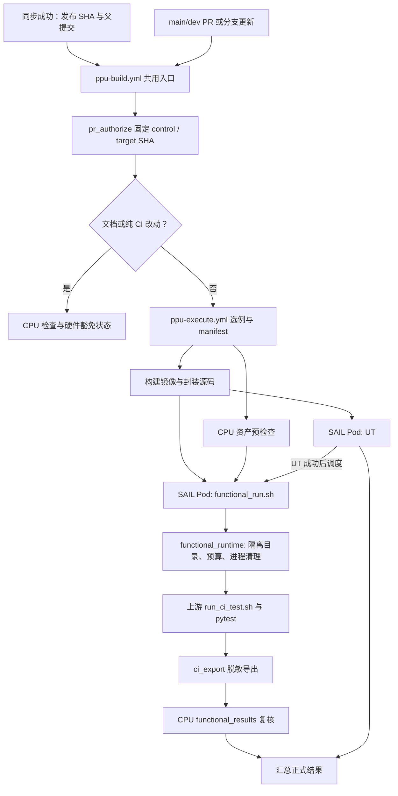

# SAIL PPU CI 维护

本分支聚焦正式 PPU CI：复用上游训练脚本与比较器，在 SAIL runner 上执行。
维护提交统一使用 `DavidSophus <95245426@qq.com>`。历史专项诊断和本地调试工具
已移出交付内容。

## 独立测试分支

`davidsophus/ppu-ci-integration` 用于集成验证，普通 push 只运行 CPU 控制测试。
测试分支与 main/dev 使用同一套入口、授权及执行组件；不向 main/dev 推送测试提交。
硬件执行使用仓库级 `sail-ppu-hardware` 串行队列；排队的 PR 在进入设备前重新检查 head/base 和状态归属。

手动触发此分支的 `PPU Build`，选择 `test_kind=smoke`，其余输入保持默认：

- UT 只运行上游 `tests/unit_tests/test_model_configs.py` bucket。
- FT 只运行 `gpt/gpt3_mcore_te_tp1_pp1_dist_optimizer_no_mmap_bin_files`，一次完整数值比较。
- 两者使用同一份构建产物；UT 失败则 FT 不启动。
- 这是调试证据，不是完整 UT/FT 覆盖；此模式不能用于发布 PR 成功状态。

## 同步与 PR 的统一入口

main/dev 同步发布成功后，worker 输出 `sync_request`（被测 SHA、两个父提交、发布分支），
父 workflow 直接调用 `ppu-build.yml` 的 `workflow_call`，再复用同一套 Build→UT→FT。
不依赖 `GITHUB_TOKEN` 的 push 触发后续 Actions。main 和 dev 的 artifacts、NAS 目录分别使用
`sync-main-` / `sync-dev-` 前缀，共享同一个硬件队列。

普通分支更新、同步及无标签 PR 默认使用相同的上游 L0 数值测试、一次重复、30 分钟预算。
`Run tests` 保留显式轻量观察模式，`Run functional tests` 可扩大到 L1；常规路径不需要标签。
文档和纯 CI 编排变更仅走 CPU 检查；执行器、镜像/依赖、recipe、golden、被测代码变更仍运行硬件测试。
改名同时检查原路径，变更列表不完整时不豁免。

GitHub 自 2025-12-08 起从默认分支加载 `pull_request_target`，即使 PR 合入 dev，控制代码仍来自 main。
因此入口用 PR 的 `base.ref` 判断目标分支，用默认分支 SHA 固定控制代码。
独立分支通过真实 PR 的 full-SHA 手动授权验证执行和状态；自动 PR 事件入口必须在 main 上线后验收。
参考：[GitHub 变更说明](https://github.blog/changelog/2025-11-07-actions-pull_request_target-and-environment-branch-protections-changes/)。

测试同步接线时，在独立分支调度同步 workflow 并设置 `sandbox_handoff=true`。
它只读取固定的 `davidsophus/ppu-sync-main` / `davidsophus/ppu-sync-dev` 测试引用，要求两个父提交分别是
当前 main/dev 基线与当前控制 SHA，再调用同一流水线的最小诊断模式；不发布到 main/dev，不创建同步 PR。
此模式验证发布后的接线和 SHA 隔离，不代表实际上游合并或完整测试集通过。

## 执行路径



combined 流程仅在 UT 成功后启动 functional；最终组合结果要求 UT 和 functional 都成功。
`control_sha` 标识控制代码，`target_sha` 标识被测源码；训练 PR 在旧 control 下通过，
不能证明该 PR 修改的 CI 脚本已被执行。新控制代码需要单独的 CPU 验证和开发环境验证，
不能为此放开正式授权规则。

## 保留的脚本与责任

以下文件均位于 `.github/scripts/`。CPU 测试在其 `tests/test_ppu_*.py` 下。

| 文件 | 维护职责 |
|---|---|
| `ppu_policy.py` | 受信任分支、最小诊断 case、CPU 豁免路径和同步产物前缀 |
| `ppu_pr_authorize.py` | 授权、SHA、过期状态与 PR 状态归属 |
| `ppu_ci.py`、`ppu_pytest_policy.py` | UT 选例、manifest、排除策略、结果门槛和证据 |
| `ppu_ci_build.sh`、`ppu_ci_run.sh` | 构建准备和 UT 执行 |
| `ppu_ci_container.py`、`.sh` | 镜像指纹、构建、导出/恢复和产物校验 |
| `ppu_ci_paths.py`、`ppu_ci_export.py` | CPU/Pod 存储映射与公共产物脱敏 |
| `ppu_functional.py` | recipe/golden 选择、计划与资产清单 |
| `ppu_functional_snapshot.py` | baseline 配置和 golden 的 SHA256 清单 |
| `ppu_functional_hf.py` | 固定版本 tokenizer、receipt 与离线缓存 |
| `ppu_functional_environment.py` | 包/API/工具/设备/编译环境检查 |
| `ppu_functional_run.sh` | 正式 Pod 执行入口：镜像、环境、runtime |
| `ppu_functional_runtime.py` | 上游 shell 调用、重复/预算/重试、进程族清理 |
| `ppu_functional_pytest.py`、`ppu_functional_results.py` | pytest 证据记录及完整结果复核 |

进程族发现与信号清理函数现位于 runtime 内，不依赖诊断脚本；保留跨 session、孤儿进程、
PID 重用、超时、取消和实际子进程清理测试。正常日志、错误分类、环境检查不属于可删除的
临时 debug 内容。模型配置、golden、比较器及正式门槛未随此次清理修改。

## 最小验证顺序

先在具备 Python 3.12 和 `.github/docker/control-requirements.txt` 依赖的 CPU 环境中检查。
不要为控制脚本在宿主机安装 Megatron GPU 依赖或同步整个项目环境。

```bash
# 只验证选例与锁定文件，不申请 Pod，也不检查 NAS 是否可读。
PPU_INPUTS='{"functional_cases":"gpt/gpt3_mcore_te_tp1_pp1_dist_optimizer_no_mmap_bin_files"}' \
  python .github/scripts/ppu_functional.py catalogue > /tmp/ppu-catalogue.json

# 控制脚本回归；训练与数值检查使用合成证据，不占用 PPU。
PYTEST_DISABLE_PLUGIN_AUTOLOAD=1 python -m pytest -q \
  .github/scripts/tests/test_ppu_functional.py \
  .github/scripts/tests/test_ppu_functional_runtime.py \
  .github/scripts/tests/test_ppu_functional_results.py
```

需要 NAS 或设备验证时，在 `ppu-build.yml` 的受信任分支上手动选择下列输入。
功能测试控制 Build/UT，其他 UT 开关保持默认值；不要提交 `all` 个 case。

| 输入 | 首先检查资产 | 确需训练时 |
|---|---|---|
| `test_kind` | `functional` | `functional` |
| `functional_mode` | `assets` | `regression` |
| `functional_scope` | `all`（由下列精确 case 再过滤） | 同左 |
| `functional_cases` | `gpt/gpt3_mcore_te_tp1_pp1_dist_optimizer_no_mmap_bin_files` | 同左 |
| `functional_repeat` | `1` | `1` |
| `functional_timeout` | `5` | `5` 分钟总训练预算 |

这个普通 GPT case 为 TP1/PP1、12 层、hidden size 512、50 步；选择它是为了减少特性组合，
不是声称它已经实测最快。需要数据、vocab/merges 和固定的 GPT2 tokenizer 缓存。
现有执行器仍要求单机 **8 卡**。`repeat=1` 不关闭正式基础设施重试：最多 3 次 attempt
共用预算；排队、构建、资产预检查和退出清理另有开销。冷编译可能耗尽预算，不能据此判精度失败。

最小集成调试使用本页的 `smoke` 入口；历史四步专项诊断不属于当前交付。
需要时独立 checkout 使用，并记录实际 control/target SHA；其 smoke 结果不计作精度通过。

已有正式产物直接在 CPU 复核，不重跑训练：

```bash
python .github/scripts/ppu_functional_results.py \
  --manifest /path/to/manifest.json --root /path/to/target --results /path/to/results
```

结果目录保留 `functional-000/` 等子目录中的原始环境、action、rank、pytest、TensorBoard
和导出证据。先定位失败阶段，再选择一个相关 case。`ckpt-resume` 检查保存/加载，不能证明
故障注入后的自动恢复；一次 numeric 或 smoke 也不能证明性能稳定。

## 维护约定

我们分别维护平台环境、测试控制、模型基线、发布门禁；变更附对应的环境报告、CPU 测试、
采样证据或 control/target 身份。长期 CODEOWNERS 沿用项目真实授权关系，不虚构维护账号。
四项交付以此说明、现有最小调用方式、CPU 自验证和责任边界为基础逐步完善。

依赖由项目 `pyproject.toml`/`uv.lock`、PPU CI Dockerfile、CPU requirements 和 tokenizer lock
分别管理；产品镜像 `docker/Dockerfile.ppu` 另有用途，不能因名称含 PPU 就当作调试文件删除。
禁止通过现场 pip 修复或改 golden 掩盖失败。历史 `_2nd.json` 保留采样来源；resume 比较本次
第一阶段与恢复阶段。以后清理重复配置或依赖漂移，应另立小改动验证。

本地 CPU 验证不代表远程 Linux runner、SAIL 训练、精度或性能验收；硬件验证单独记录。
