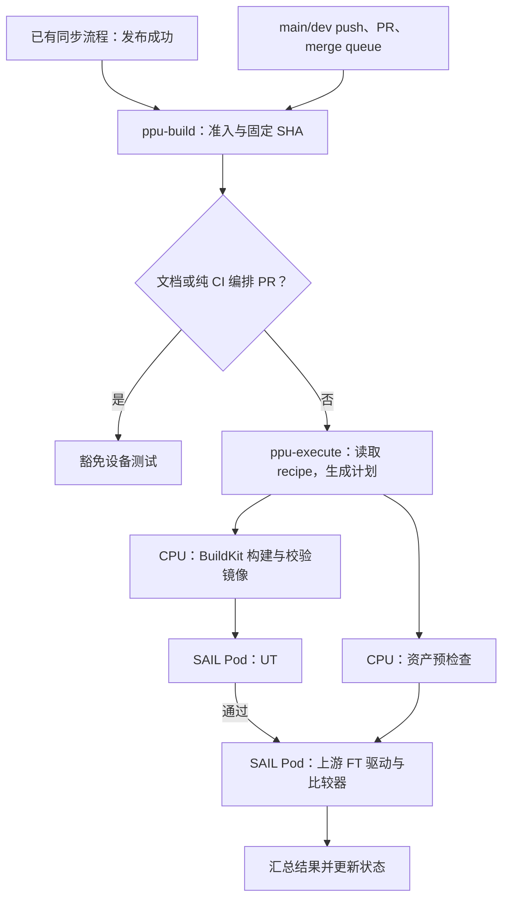

# SAIL PPU CI

复用 NV recipe、UT/FT 驱动和数值比较器。SAIL 只维护准入与选例、平台镜像、
runner/NAS 接线、M890 golden 和结果汇总；不在适配层重新实现模型测试。

## 流程与触发



- 同步沿用现有 main 候选 PR / dev 直接发布机制。发布后通过 `sync_request`
  调用 `ppu-build.yml`，无需依赖 `GITHUB_TOKEN` push 再触发 Actions。
- 普通 push、同步和无标签 PR：UT quick、FT L0、重复一次、每 case 30 分钟训练预算。
  `Run tests` 选择轻量观察，`Run functional tests` 扩大到 L1。
- 文档和纯编排 PR 豁免设备；镜像、依赖、执行脚本、recipe、golden 和模型代码仍需测试。
  自动 combined 路径先 UT 后 FT，共用镜像；任一失败则组合失败。
- 手动 `ppu-build.yml` 支持单 UT bucket、FT assets 或 regression。assets 不训练；
  release tag 当前只执行 UT。正式入口只允许 main/dev，临时验证分支另行维护。
- `ppu-control-tests.yml` 是独立的 CPU 脚本回归，只在相关路径 PR 或手动运行时执行，
  不是每次 Build/UT/FT 的前置 job，也不消耗 PPU。

`ppu_policy.py` 集中维护规则；`ppu_pr_authorize.py` 读取 GitHub 状态、固定 head/base/merge SHA，
并在排队后复查，防止旧提交的结果用于新提交。SAIL 保留 `pull_request_target` 入口，
没有接入 NV copy-pr-bot 或 NV runner。控制代码来自受信任分支，被测代码使用固定的 target SHA。

## 维护入口

下表脚本均在 `.github/scripts/`；只为实际平台差异保留适配，不增加通用 CI 框架。

| 内容 | 入口 |
|---|---|
| 触发、权限、测试范围 | `ppu_policy.py`、`ppu_pr_authorize.py`；UT quick 清单 `.github/ppu-pr-tests.json` |
| UT | `ppu_ci.py`、`ppu_ci_run.sh`、`ppu_pytest_policy.py`，调用上游 UT 驱动 |
| FT 选例与运行 | `ppu_functional.py`、`ppu_functional_runtime.py`，调用上游 `run_ci_test.sh` |
| 平台环境 | `.github/docker/Dockerfile.ppu-ci`、`ppu_ci_container.py`、`ppu_functional_environment.py` |
| 数据与 tokenizer | `ppu_ci_paths.py`、`ppu_functional_hf.py`、`.github/ppu-functional-tokenizers.json` |
| 结果与日志 | `ppu_functional_results.py`、`ppu_functional_pytest.py`、`ppu_ci_export.py` |

仓库变量 `PPU_CI_ENABLED=true` 开启设备流程；environment 使用 `ppu-ci`。
存储接线使用 secrets：`PPU_HOST_VOLUMES`、`PPU_CPU_RUN_ROOT`、`PPU_POD_RUN_ROOT`、
`PPU_CPU_ASSETS_ROOT`、`PPU_POD_ASSETS_ROOT`。CPU 与 Pod 路径必须映射到同一共享数据。
公共 artifacts 只导出 JSON 报告/指标、原始模型配置、文本日志及必要的控制脚本，并脱敏路径。
其余文件（含展开配置、TensorBoard、checkpoint 和缓存）保留 NAS；不另建上传文件清单协议。

## 镜像与缓存

构建在 GitHub CPU runner 上进行，基础镜像来自 SAIL；运行镜像以 GHCR digest 交给 PPU。
源码和编译产物保存在镜像的 `/opt/ppu-ci-source`，与 cluster-task 搬运工作区的
`/opt/megatron-lm` 分开；Build/UT/FT 不再额外打包或解压源码。
依赖来自被测 `pyproject.toml` 的 project/test/training 配置及 SAIL 原生包约束，
当前不直接消费 NV `uv.lock`。安装与源码编译在镜像构建阶段完成，Pod 内不现场安装依赖。
Build 统一检查依赖和 UT tokenizer 缓存；各 UT bucket 验证同一镜像、数据交付及设备可见性后运行。
运行环境只接受镜像交付；CPU 控制解释器仍通过独立归档分发。
预检查确认依赖版本、导入、launcher 和平台后端；checkpoint、Apex 等上游内部 API 的
调用兼容性由原始 UT/FT 验证，适配层不再解析其内部方法签名或维护实现位置映射。

`.github/actions/ppu-build-cache/action.yml` 选择 registry BuildKit 依赖缓存：
PR 优先读自己的同指纹缓存，再读目标分支；PR/候选提交分别写独立缓存，main/dev 发布提交更新 baseline。
指纹由基础镜像 digest、平台和依赖构建输入决定；普通源码变化仍编译源码，但可以复用依赖层。
缓存存放于 SAIL GHCR，不使用 NV 资源。`ppu-populate-build-cache.yml` 可在 CPU 上预热，
不是每个 PR 的必需步骤，也不设置周期性预热。

## M890 golden

使用 `tests/functional_tests/test_cases/<model>/<case>/golden_values_dev_m890.json`。
配置默认复用同目录 `model_config.yaml`；只有保留平台参数差异时才提供 `model_config_m890.yaml`。
Git 管理 golden 版本，无需中央 baselines JSON 或 snapshot 脚本。

`m890_model_config()` 集中适配 launcher：默认 torchrun，已有五个 FT launcher case 保持原样。
历史 `_2nd.json` 只保留采样记录；ckpt-resume 比较本次两阶段输出，不等于验证故障注入恢复。
轻量观察、缺资产跳过均不计作数值通过；缺 golden 或比较失败不能静默通过。
数值比较（含性能 warmup 窗口和指标支持）只由上游 pytest 执行。适配层记录比较输入摘要与结果，
汇总检查结果绑定、重复次数和执行完整性，不再重新执行数值比较，也不需要 checkout 被测源码。

## 最小验证

在 Python 3.12 CPU 环境安装 `ppu-control-tests.yml` 声明的依赖；不安装宿主机 GPU 环境。
改适配脚本先跑对应测试文件，合并前跑保留的关键回归：

```bash
python -m pytest -q -o addopts= .github/scripts/tests
```

上线后的手动诊断从 main 调度；独立验证分支使用该分支专用入口。每次只选一个 case：

```bash
gh workflow run ppu-build.yml --repo flytiger-eco/Megatron-LM-for-sail --ref main \
  -f test_kind=functional -f functional_mode=assets -f functional_scope=all \
  -f functional_cases=gpt/gpt3_mcore_te_tp1_pp1_dist_optimizer_no_mmap_bin_files \
  -f functional_repeat=1 -f functional_timeout=15
```

资产通过后将 `functional_mode` 改为 `regression` 才申请 PPU；该 case 为 50 步，当前 runner 为单机 8 卡。
UT 单 bucket 使用 `test_kind=unit scope=full suite_family=nvidia-dev unit_bucket=tests/unit_tests/test_model_configs.py repeat=1`。
检查 UT failed=0；FT 检查 `numerical_validation=true`、`numeric_passed=1`、`numeric_failed=0`。
CPU 回归、assets 成功和镜像缓存命中都不代表训练精度或性能已验收。

失败先按 authorize / configure / assets / runtime-environment / UT / FT 定位；保留日志与对应 SHA。
仅已识别的基础设施故障允许在 case 剩余预算内重试；数值失败不靠重试或修改 golden 消除。
历史调试记录查 Git 历史和 Actions，不在这份维护说明中累积运行日志。
